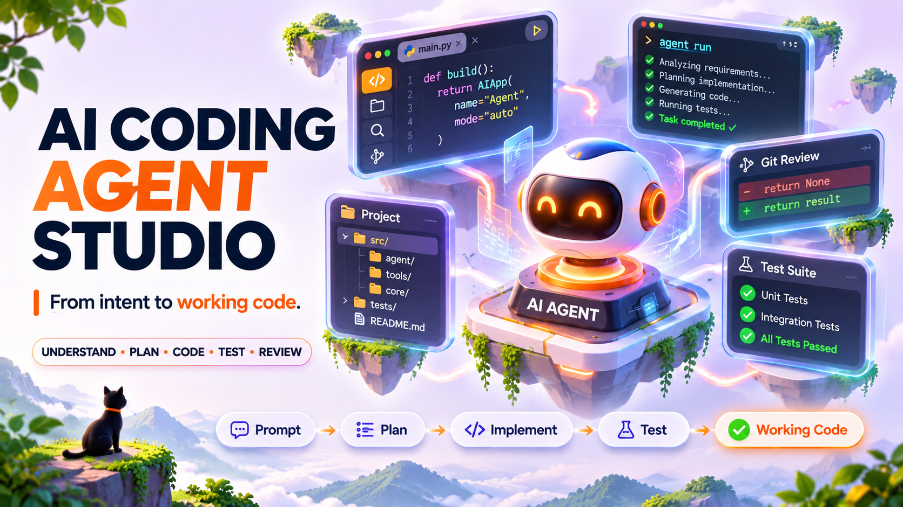
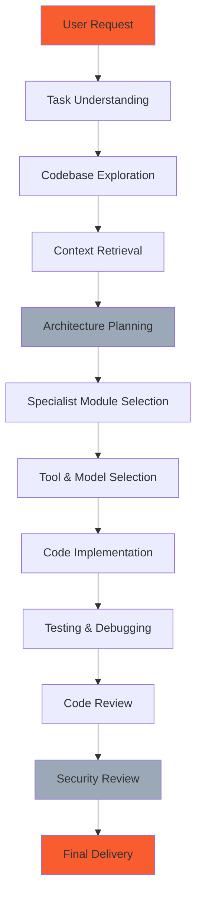

<div align="center">



[](https://claude.ai/code) [](https://github.com/opencoder-llm/opencoder) [](https://github.com/TheMamunZx/ai-coding-agent-studio) [](https://github.com/TheMamunZx/ai-coding-agent-studio)

**Build autonomous coding agents with repository intelligence, tool contracts, bounded execution, and human-centered design.**

[Quick Start](#quick-start) · [Master Skill](#master-skill-architecture) · [Installation](#claude-code-installation) · [Documentation](#documentation-and-resources)

</div>

---

## About AI Coding Agent Studio

AI Coding Agent Studio provides a complete development framework for building production-capable autonomous coding agents. Design agents that understand codebases, execute tool calls safely, maintain context across sessions, coordinate multi-agent workflows, and deliver professional developer experiences.

This is **not** a tool for using existing coding agents. This is a comprehensive development studio for **creating** your own coding agents from scratch.

### Key Capabilities

- **Autonomous Agent Development** — Build agents that plan, execute, and recover from failures
- **Codebase Intelligence** — Index, search, and understand repository structure and semantics
- **Tool Calling & MCP** — Design function schemas, MCP servers, and permission-aware execution
- **Context & Memory** — Manage token budgets, session state, and persistent agent memory
- **Multi-Agent Orchestration** — Coordinate parallel workflows, delegation, and agent communication
- **AI-Powered IDEs** — Create terminal interfaces, editor integrations, and IDE extensions
- **Human-Centered Design** — Build professional, accessible, purposeful developer experiences
- **Security & Sandboxing** — Implement approval gates, safe execution, and credential protection

---

## Project Overview and Statistics

| Metric | Value |
|--------|-------|
| **Master Skills** | 1 discoverable entry point |
| **Internal Modules** | 10 specialist references |
| **Architecture Layers** | Agent, Tool, Context, Memory, Execution, UI |
| **Design Modules** | 3 human-centered quality references |
| **Compatible Platforms** | Claude Code, OpenCode, Custom Runtimes |
| **Primary Models** | Claude 5.5 (Opus, Sonnet, Haiku, Fable) |

---

## What Can You Build?

### Autonomous Coding Agents

- Repository understanding and navigation
- Multi-file refactoring with conflict detection
- Automated testing and debugging workflows
- Code review and quality analysis
- Documentation generation and maintenance

### AI-Powered Development Tools

- Terminal-based coding assistants
- IDE extensions with inline completions
- Code search and semantic navigation
- Automated dependency updates
- Build and deployment automation

### MCP Servers and Tool Integrations

- Custom tool schemas and validators
- Permission-aware execution layers
- External API and service connectors
- File system and Git operations
- Database and cloud infrastructure tools

### Multi-Agent Systems

- Parallel code review workflows
- Distributed testing and validation
- Agent specialization and delegation
- Coordination protocols and state machines
- Fault tolerance and recovery patterns

---

## Master Skill Architecture

AI Coding Agent Studio exposes **one discoverable Master Skill**:

```
ai-coding-agent-studio
```

Users select **only the Master Skill**. Internal specialist modules are loaded automatically based on the task. This prevents fragmentation and ensures coordinated workflows.

### Discovery and Invocation

**Claude Code:**
```text
/ai-coding-agent-studio
```

**OpenCode:**
```text
@ai-coding-agent-studio
```

**Custom Runtimes:**
```text
Load .claude/skills/ai-coding-agent-studio/SKILL.md
```

The Master Skill inspects the request, loads relevant internal references, and orchestrates the complete development workflow without manual module selection.

---

## Internal Specialist Modules

10 internal reference playbooks coordinate agent development capabilities:

| Module | Purpose |
|--------|---------|
| **ai-agent-architect** | Agent system design, state machines, task planning |
| **coding-agent-engineer** | Autonomous coding workflows, codebase modification |
| **mcp-server-engineer** | MCP protocol, server development, tool integration |
| **function-calling-engineer** | Tool schemas, validation, permission contracts |
| **multi-agent-engineer** | Parallel coordination, delegation, communication |
| **agent-memory-engineer** | Persistent memory, context retrieval, session state |
| **codebase-intelligence** | Repository indexing, semantic search, understanding |
| **human-centered-product-design** | Developer experience, interface design, accessibility |
| **design-quality-critic** | Visual hierarchy, consistency, professional polish |
| **product-experience-engineer** | Interaction patterns, navigation, clear communication |

These modules are internal references, not separate discoverable skills. The Master Skill loads them as needed.

---

## AI Coding Agent Architecture

### Core Agent Layers



### Architecture Components

Where supported by runtime and configuration:

**Agent Orchestrator**
- Task decomposition and planning
- Specialist module routing
- Execution coordination and monitoring
- Failure detection and recovery

**Model & Provider Layer**
- Multi-provider support (Anthropic, OpenAI, Google, local)
- Model selection and fallback strategies
- Rate limiting and quota management
- Streaming and batch processing

**Context & Memory Layer**
- Token budget management
- Session state persistence
- Long-term memory storage
- Context window optimization

**Codebase Intelligence Layer**
- Repository indexing and search
- AST parsing and semantic analysis
- Dependency graph construction
- Change impact analysis

**Tool Calling Layer**
- Function schema validation
- MCP server integration
- Tool execution and sandboxing
- Permission and approval gates

**Execution & Permission Layer**
- Safe command execution
- File system access control
- Git operation permissions
- Approval workflow management

**Testing & Evaluation Layer**
- Automated test execution
- Agent behavior validation
- Performance measurement
- Quality metrics tracking

**User Interface & IDE Integration**
- Terminal interface rendering
- Editor extension APIs
- Status and progress indicators
- Error and recovery messaging

Actual implementation depends on target runtime, available tools, and project configuration.

---

## Autonomous Coding Workflow

Agent workflow varies by task complexity and available capabilities:

1. **Task Understanding** — Parse user request, identify deliverables, detect ambiguity
2. **Codebase Exploration** — Index repository, map structure, identify conventions
3. **Context Retrieval** — Load relevant files, dependencies, documentation, history
4. **Architecture Planning** — Design changes, assess impact, plan execution phases
5. **Module Selection** — Load specialist references matching task requirements
6. **Tool Selection** — Choose appropriate tools, models, execution strategies
7. **Implementation** — Generate code, modify files, preserve working behavior
8. **Testing** — Run tests, validate changes, verify quality gates
9. **Review** — Check security, permissions, accessibility, performance
10. **Delivery** — Report changes, unresolved issues, manual verification needed

Agents skip unnecessary steps, parallelize independent work, and recover from failures.

---

## Codebase Intelligence and Context Understanding

### Repository Analysis

- **Structure Mapping** — Directory layout, module organization, entry points
- **Dependency Discovery** — Package managers, lock files, imports, API usage
- **Convention Detection** — Naming patterns, formatting, architecture styles
- **Change Impact** — Modified files, affected tests, breaking changes

### Semantic Understanding

- **AST Parsing** — Syntax trees, symbol tables, type information
- **Cross-Reference** — Function calls, class hierarchies, data flow
- **Documentation** — Comments, docstrings, README files, external docs
- **Test Coverage** — Test files, assertions, mocked dependencies

### Context Selection

- **Token Budget** — Prioritize relevant context within model limits
- **Freshness** — Prefer recent files, active branches, current dependencies
- **Relevance Scoring** — Match files to task based on semantic similarity
- **Incremental Loading** — Stream context as needed during execution

Implementation depends on available indexing tools, language servers, and runtime capabilities.

---

## Agent Memory and Context Management

### Memory Types

**Session Memory**
- Current task state and progress
- Active file contents and modifications
- Tool execution history and results
- User preferences and corrections

**Project Memory**
- Codebase structure and conventions
- Architectural decisions and constraints
- Recurring patterns and solutions
- Test strategies and quality gates

**User Memory**
- Expertise level and role
- Communication preferences
- Approval requirements and risk tolerance
- Domain knowledge and context

### Memory Operations

- **Write** — Store verified facts, user feedback, project constraints
- **Recall** — Retrieve relevant memories based on current task
- **Update** — Merge new information, correct outdated memories
- **Delete** — Remove incorrect or superseded information

### Context Optimization

- **Compression** — Summarize long conversations preserving key decisions
- **Caching** — Reuse unchanged context across turns with prompt caching
- **Pruning** — Drop irrelevant history beyond context window
- **Checkpointing** — Save recoverable state for long-running tasks

Memory location: `.claude/projects/<project-hash>/memory/`

---

## Tool Calling and Function Calling

### Tool Design Principles

- **Explicit Schemas** — JSON Schema with required parameters, types, constraints
- **Clear Descriptions** — Purpose, parameters, return values, side effects
- **Idempotency** — Safe retries, no unintended duplicate operations
- **Error Handling** — Structured errors, recovery suggestions, partial success

### Permission Model

| Risk Level | Action | Permission |
|------------|--------|------------|
| **Low** | Read files, list directories, search code | Auto-approve |
| **Medium** | Edit files, run tests, install dependencies | Notify user |
| **High** | Delete files, deploy, modify production | Require approval |

### Tool Categories

**File Operations**
- Read, Write, Edit, Delete, Move, Copy
- Glob patterns, content search, batch operations
- Permission checks, backup creation

**Code Execution**
- Shell commands, script execution, REPL interaction
- Sandboxed environments, timeout limits
- Output capture, error handling

**Version Control**
- Git read (log, diff, blame, status)
- Git write (commit, branch, push, PR creation)
- Repository analysis, conflict detection

**External Services**
- API calls with authentication
- Database queries and migrations
- Cloud resource management

Actual tool availability depends on runtime configuration and installed integrations.

---

## MCP Server Development

Model Context Protocol (MCP) enables standardized tool integration across agent runtimes.

### MCP Server Capabilities

**Resources**
- Expose repository files, documentation, configuration
- Provide templates, schemas, reference examples
- Stream large datasets with pagination

**Tools**
- Define callable functions with JSON Schema
- Implement execution logic with permission checks
- Return structured results and errors

**Prompts**
- Suggest contextual prompts based on state
- Provide agent guidance for specific tasks
- Template common workflows

### MCP Development Workflow

1. **Design Protocol** — Define resources, tools, prompts contract
2. **Implement Server** — Build MCP server with SDK or custom implementation
3. **Add Permissions** — Implement approval gates for sensitive operations
4. **Test Integration** — Verify tool discovery, execution, error handling
5. **Deploy** — Configure agent runtime to connect to MCP server

### MCP Security

- **Input Validation** — Sanitize parameters, reject malformed requests
- **Credential Management** — Secure storage, scoped access, rotation
- **Audit Logging** — Record tool calls, parameters, results, approvals
- **Sandbox Execution** — Isolate tool execution from host system

Example servers: file system, Git operations, API connectors, database tools.

---

## Multi-Agent Orchestration

### Coordination Patterns

**Sequential Pipeline**
- Task A completes → Task B starts with A's output
- Linear dependency chain
- Failure stops pipeline

**Parallel Execution**
- Independent tasks run simultaneously
- Results aggregated when all complete
- One failure doesn't block others

**Hierarchical Delegation**
- Coordinator assigns subtasks to specialists
- Specialists report results to coordinator
- Coordinator synthesizes final output

**Consensus Review**
- Multiple agents review same artifact independently
- Results compared for agreement or conflict
- Human resolves disagreements

### Agent Communication

**Direct Messaging**
- Send structured messages between agents
- Request information, delegate tasks
- Report progress and errors

**Shared State**
- Write to shared memory or file system
- Read other agents' outputs
- Coordinate via state machine transitions

**Event Bus**
- Publish events for state changes
- Subscribe to relevant event types
- Decouple agents via pub/sub

### Failure Handling

- **Retry** — Automatic retry with exponential backoff
- **Fallback** — Switch to alternative strategy or agent
- **Partial Success** — Return completed work, report failures
- **Graceful Degradation** — Continue with reduced functionality
- **Cancel** — User-initiated task termination

Multi-agent features depend on runtime support for background execution and inter-agent communication.

---

## AI-Powered IDE Development

### Terminal Integration

**Command Interface**
- Natural language to CLI translation
- Command composition and chaining
- Interactive prompts and confirmations
- Output parsing and summarization

**Process Management**
- Background task execution
- Progress indicators and status
- Log tailing and filtering
- Signal handling and cancellation

**Environment**
- Working directory awareness
- Environment variable management
- Shell configuration and PATH
- Cross-platform compatibility

### Editor Integration

**Inline Actions**
- Code completions and suggestions
- Refactoring and quick fixes
- Error explanations and fixes
- Documentation lookup

**Workspace Operations**
- Multi-file search and replace
- Project-wide refactoring
- Dependency updates
- Test generation

**UI Components**
- Sidebar panels and tree views
- Webview panels with rich content
- Status bar indicators
- Notification and progress UI

### IDE Extension APIs

Platform-specific integration points:

- **VS Code** — Extension API, Language Server Protocol, Debug Adapter Protocol
- **JetBrains** — IntelliJ Platform SDK, PSI, Actions, Tool Windows
- **Vim/Neovim** — Lua plugins, LSP client, floating windows
- **Emacs** — Elisp packages, LSP mode, company completion

Actual IDE features require platform-specific extension development.

---

## Human-Centered Product Design

Professional developer tools require purposeful design, not generic AI templates.

### Design Principles

**Clarity**
- Clear visual hierarchy and information architecture
- Readable typography and appropriate contrast
- Meaningful labels and descriptions
- Self-explanatory interactions

**Consistency**
- Uniform spacing and alignment
- Predictable interaction patterns
- Coherent color and typography system
- Reliable mental models

**Efficiency**
- Minimal cognitive load
- Keyboard shortcuts and batch operations
- Reasonable defaults and smart suggestions
- Fast feedback loops

**Accessibility**
- Screen reader compatibility
- Keyboard navigation support
- Sufficient color contrast
- Focus indicators and error messages

### Interface Components

**Terminal UI**
- Progress indicators (spinners, progress bars)
- Status messages (info, warning, error, success)
- Interactive prompts (select, confirm, text input)
- Formatted output (tables, trees, syntax highlighting)

**Editor UI**
- Inline completions and suggestions
- Code actions and quick fixes
- Hover tooltips and documentation
- Diagnostic indicators and underlines

**Web UI**
- Dashboard and analytics views
- Configuration and settings forms
- Log and history browsers
- Real-time collaboration indicators

### Design Quality Review

The `design-quality-critic` module evaluates:

- Visual hierarchy and balance
- Typography scale and rhythm
- Color usage and contrast
- Spacing consistency
- Interactive element affordances
- Error and loading states
- Responsive behavior
- Accessibility compliance

Design quality gates apply throughout development, not as final polish.

---

## Design Quality Review

### Visual Design Checklist

- [ ] Clear visual hierarchy guides attention
- [ ] Typography is readable with appropriate scale
- [ ] Color contrast meets WCAG AA minimum
- [ ] Spacing is consistent and proportional
- [ ] Interactive elements have clear affordances
- [ ] Focus states are visible and logical
- [ ] Loading and error states are informative
- [ ] Layout adapts to different screen sizes

### Interaction Design Checklist

- [ ] Primary actions are obvious
- [ ] Destructive actions require confirmation
- [ ] Keyboard navigation works throughout
- [ ] Error messages explain what went wrong and how to fix
- [ ] Success feedback confirms completion
- [ ] Long operations show progress
- [ ] Cancel and undo are available where appropriate
- [ ] State changes are predictable

### Accessibility Checklist

- [ ] Screen reader announces relevant information
- [ ] All interactive elements are keyboard accessible
- [ ] Focus order follows logical reading order
- [ ] Color is not the only indicator of meaning
- [ ] Text alternatives provided for non-text content
- [ ] Time limits can be adjusted or disabled
- [ ] No flashing content that could trigger seizures
- [ ] Content is presented in a simple, clear manner

Full WCAG compliance requires manual testing with assistive technologies and expert accessibility review.

---

## Quick Start

### Prerequisites

- Compatible agent runtime (Claude Code, OpenCode, or custom)
- Model access (Claude 5.5 or equivalent)
- Git for version control
- Python 3.8+ for validation scripts

### Basic Usage

1. Copy `.claude/skills/ai-coding-agent-studio/` to target project
2. Invoke master skill: `/ai-coding-agent-studio` (Claude Code) or `@ai-coding-agent-studio` (OpenCode)
3. Describe agent development task
4. Review loaded modules and execution plan
5. Approve high-risk operations as needed
6. Validate deliverables with provided tests

### Example Invocations

**Build MCP Server:**
```text
/ai-coding-agent-studio create an MCP server for GitHub API integration with repo read and issue creation tools
```

**Design Agent Architecture:**
```text
/ai-coding-agent-studio design a multi-agent code review system with parallel linting, security analysis, and test coverage checks
```

**Implement Context Management:**
```text
/ai-coding-agent-studio add persistent memory for user preferences and project conventions with automatic recall
```

Agent discovery and invocation syntax varies by platform and version.

---

## Claude Code Installation

### Project-Local Installation

Copy skill directory to target project:

```bash
# Clone or download ai-coding-agent-studio
git clone https://github.com/TheMamunZx/ai-coding-agent-studio.git

# Copy to target project
cp -r ai-coding-agent-studio/.claude/skills/ai-coding-agent-studio /path/to/your/project/.claude/skills/
```

### Global Installation

Install for all projects:

```bash
# Create global skills directory
mkdir -p ~/.claude/skills

# Copy skill
cp -r ai-coding-agent-studio/.claude/skills/ai-coding-agent-studio ~/.claude/skills/
```

### Verification

Check skill is discoverable:

```bash
# Claude Code CLI
claude-code --list-skills | grep ai-coding-agent-studio

# Or invoke from Claude Code interface
/help
# Verify ai-coding-agent-studio appears in skills list
```

If skill does not appear, check:
- Skill directory structure matches `.claude/skills/<skill-name>/SKILL.md`
- SKILL.md has valid frontmatter with `name:` field
- Claude Code version supports custom skills
- File permissions allow reading skill files

---

## OpenCode Installation

### Project-Local Installation

```bash
# Copy skill to project
cp -r ai-coding-agent-studio/.claude/skills/ai-coding-agent-studio /path/to/your/project/.opencode/skills/
```

### Global Installation

```bash
# Create global skills directory
mkdir -p ~/.opencode/skills

# Copy skill
cp -r ai-coding-agent-studio/.claude/skills/ai-coding-agent-studio ~/.opencode/skills/
```

### Invocation

```text
@ai-coding-agent-studio <task description>
```

OpenCode discovery and invocation may vary by version. Consult OpenCode documentation for platform-specific instructions.

---

## Supported Models and Providers

### Primary Models

**Claude 5.5 Family** (Recommended)
- **Opus 5.5** — Most capable, complex reasoning, long context
- **Sonnet 5.5** — Balanced performance and speed
- **Haiku 5.5** — Fast responses, simple tasks
- **Fable 5.1** — Specialized creative and coding tasks

Model IDs:
```
claude-opus-5-5
claude-sonnet-5-5
claude-haiku-5-5
claude-fable-5-1
```

### Provider Configuration

Configuration methods depend on runtime:

**Environment Variables**
```bash
export ANTHROPIC_API_KEY="sk-ant-..."
export OPENAI_API_KEY="sk-..."
export GOOGLE_API_KEY="..."
```

**Configuration Files**
```json
{
  "providers": {
    "anthropic": {
      "apiKey": "env:ANTHROPIC_API_KEY",
      "models": ["claude-opus-5-5", "claude-sonnet-5-5"]
    }
  },
  "defaultProvider": "anthropic",
  "defaultModel": "claude-sonnet-5-5"
}
```

**Runtime Selection**
```text
/model claude-opus-5-5
/provider anthropic
```

### Provider Features

| Feature | Anthropic | OpenAI | Google | Local |
|---------|-----------|--------|--------|-------|
| Function Calling | ✓ | ✓ | ✓ | Varies |
| Streaming | ✓ | ✓ | ✓ | Varies |
| Prompt Caching | ✓ | Limited | ✗ | ✗ |
| Tool Use | ✓ | ✓ | Limited | Varies |
| Vision | ✓ | ✓ | ✓ | Varies |

Actual availability depends on API access, quotas, and runtime integration.

---

## API and Model Configuration

### Rate Limits and Quotas

Manage API usage:

- **Rate Limiting** — Respect provider rate limits, implement backoff
- **Quota Tracking** — Monitor token usage, cost estimation
- **Caching** — Use prompt caching to reduce costs
- **Batching** — Group independent requests when supported

### Context Management

Optimize token usage:

- **Context Window** — Claude 5.5: 200K tokens input, 16K tokens output
- **Prompt Caching** — Cache static context (codebase, documentation)
- **Compression** — Summarize conversation history
- **Selective Loading** — Load only relevant files and context

### Model Selection Strategy

Choose model based on task:

**Complex Reasoning** → Opus 5.5
- Multi-file refactoring
- Architecture design
- Complex debugging

**Balanced Tasks** → Sonnet 5.5
- Code review
- Test generation
- Documentation

**Simple Operations** → Haiku 5.5
- Syntax fixes
- Formatting
- Quick lookups

### Fallback Handling

Implement graceful degradation:

1. **Primary Model** — Try requested model first
2. **Fallback Model** — Switch to cheaper/faster alternative if primary fails
3. **Partial Completion** — Return partial results if budget exhausted
4. **User Notification** — Inform user of model switches or limitations

Fallback logic requires custom implementation in agent runtime.

---

## Permissions, Sandboxing and Security

### Permission Levels

**Auto-Approve** (Low Risk)
- Read files and directories
- Search codebase
- List Git history
- View configuration

**Notify** (Medium Risk)
- Edit existing files
- Create new files
- Install dependencies
- Run tests

**Require Approval** (High Risk)
- Delete files or directories
- Modify production configuration
- Deploy to remote servers
- Execute arbitrary commands
- Commit and push code

### Sandboxing Strategies

**File System Isolation**
- Restrict access to project directory
- Prevent reading sensitive files (.env, credentials)
- Block writes outside allowed paths

**Command Execution**
- Whitelist allowed commands
- Block dangerous operations (rm -rf, dd, curl to external URLs)
- Run in restricted shell environment

**Network Isolation**
- Block outbound connections except approved APIs
- Prevent data exfiltration
- Require approval for external service calls

### Security Best Practices

**Credential Management**
- Never commit secrets to repository
- Use environment variables or secure vaults
- Rotate credentials regularly
- Scope access to minimum required

**Input Validation**
- Sanitize user input in tool parameters
- Validate file paths and command arguments
- Reject malicious patterns (path traversal, command injection)

**Audit Logging**
- Log all tool calls with parameters
- Record approval decisions
- Track file modifications and command execution
- Enable forensic analysis

**Error Handling**
- Don't leak sensitive information in error messages
- Sanitize stack traces and logs
- Provide safe error recovery paths

Security features depend on runtime implementation. Verify actual security posture through testing.

---

## Testing and Agent Evaluation

### Test Categories

**Unit Tests**
- Tool function correctness
- Schema validation
- Permission checks
- Error handling

**Integration Tests**
- Tool execution in runtime environment
- MCP server communication
- File system operations
- Git integration

**End-to-End Tests**
- Complete agent workflows
- Multi-step task completion
- Error recovery
- User interaction

**Adversarial Tests**
- Prompt injection resistance
- Unsafe command detection
- Permission boundary enforcement
- Credential leak prevention

### Evaluation Metrics

**Correctness**
- Task completion rate
- Code quality (linting, type checking)
- Test pass rate
- Behavioral correctness

**Safety**
- Unauthorized operation attempts
- Sensitive data exposure
- Destructive action prevention
- Security vulnerability introduction

**Efficiency**
- Token usage per task
- API call count
- Execution time
- Resource utilization

**Reliability**
- Error recovery success rate
- Partial completion handling
- State consistency
- Crash and restart behavior

### Validation Script

Run project validation:

```bash
python scripts/validate_pack.py
```

Checks:
- Master skill frontmatter and structure
- Internal module files exist
- No accidental secrets in files
- Basic markdown and link integrity

Does not verify runtime behavior, API availability, or production readiness.

---

## Performance and Reliability

### Performance Optimization

**Token Efficiency**
- Minimize context through selective loading
- Use prompt caching for static content
- Compress conversation history
- Stream responses for perceived speed

**Execution Speed**
- Parallel tool execution where independent
- Batch file operations
- Cache expensive computations (AST parsing, indexing)
- Lazy load heavy dependencies

**Resource Management**
- Limit concurrent agent count
- Timeout long-running operations
- Clean up temporary files
- Monitor memory usage

### Reliability Patterns

**Idempotency**
- Tool calls produce same result when retried
- No accidental duplicate operations
- Safe to replay after failures

**Checkpointing**
- Save progress at logical boundaries
- Resume from last checkpoint after crash
- Report partial completion

**Error Recovery**
- Retry transient failures with backoff
- Fallback to alternative strategies
- Graceful degradation
- Clear error messages with recovery suggestions

**State Consistency**
- Atomic file operations
- Transaction-like multi-step changes
- Rollback on failure
- Verify state after recovery

### Monitoring and Observability

- **Logging** — Structured logs for debugging and audit
- **Metrics** — Track task success rate, latency, token usage
- **Tracing** — Follow execution through agent, tools, model
- **Alerts** — Notify on repeated failures or anomalies

Monitoring infrastructure depends on deployment environment.

---

## Build and Deployment Guide

### Local Development

```bash
# Clone repository
git clone https://github.com/TheMamunZx/ai-coding-agent-studio.git
cd ai-coding-agent-studio

# Validate structure
python scripts/validate_pack.py

# Test in local project
cp -r .claude/skills/ai-coding-agent-studio /path/to/test/project/.claude/skills/

# Invoke from agent
/ai-coding-agent-studio <task>
```

### Continuous Integration

Example CI workflow:

```yaml
name: Validate Skill
on: [push, pull_request]
jobs:
  validate:
    runs-on: ubuntu-latest
    steps:
      - uses: actions/checkout@v3
      - uses: actions/setup-python@v4
        with:
          python-version: '3.10'
      - run: python scripts/validate_pack.py
```

### Distribution

**Direct Copy**
- Users copy `.claude/skills/` directory to their projects
- Simple, no dependencies
- Manual updates

**Git Submodule**
```bash
git submodule add https://github.com/TheMamunZx/ai-coding-agent-studio.git skills/ai-coding-agent-studio
git submodule update --init --recursive
```

**Package Manager**
- Future: skill registry or package distribution
- Automated updates and dependency resolution
- Currently not implemented

### Versioning

Follow semantic versioning:

- **Major** — Breaking changes to skill interface or behavior
- **Minor** — New modules, backward-compatible features
- **Patch** — Bug fixes, documentation updates

Tag releases:
```bash
git tag -a v1.2.0 -m "Add multi-agent coordination module"
git push origin v1.2.0
```

---

## Output Structure and Deliverables

### Agent Deliverables

Typical agent project outputs:

```
agent-project/
├── src/
│   ├── agent/
│   │   ├── orchestrator.py       # Main agent loop
│   │   ├── planner.py             # Task decomposition
│   │   └── executor.py            # Tool execution
│   ├── tools/
│   │   ├── schemas.py             # Tool definitions
│   │   ├── file_ops.py            # File operations
│   │   └── git_ops.py             # Git operations
│   ├── context/
│   │   ├── indexer.py             # Codebase indexing
│   │   ├── retrieval.py           # Context selection
│   │   └── memory.py              # Persistent memory
│   └── ui/
│       ├── terminal.py            # Terminal interface
│       └── components.py          # UI components
├── tests/
│   ├── test_tools.py
│   ├── test_agent.py
│   └── test_integration.py
├── config/
│   ├── models.json                # Model configuration
│   └── permissions.json           # Permission policies
├── docs/
│   ├── architecture.md            # System design
│   ├── tools.md                   # Tool documentation
│   └── evaluation.md              # Test results
└── README.md
```

### Documentation Requirements

**Architecture Document**
- System design and component diagram
- Agent state machine
- Tool calling flow
- Context management strategy

**Tool Documentation**
- Each tool's schema and description
- Permission requirements
- Example usage
- Error conditions

**Evaluation Report**
- Test scenarios and results
- Performance metrics
- Known limitations
- Security considerations

**User Guide**
- Installation and configuration
- Common usage patterns
- Troubleshooting
- API reference

---

## Troubleshooting and FAQ

### Common Issues

**Skill Not Discovered**
- Check file path: `.claude/skills/ai-coding-agent-studio/SKILL.md`
- Verify frontmatter has `name: ai-coding-agent-studio`
- Ensure file permissions allow reading
- Restart agent runtime after installation
- Check agent version supports custom skills

**Module Not Loading**
- Verify module file exists in `references/` directory
- Check module name matches manifest
- Review agent logs for load errors
- Ensure module markdown is valid

**Tool Execution Fails**
- Check tool is implemented in runtime
- Verify parameters match schema
- Review permission requirements
- Check for environment setup (API keys, dependencies)
- Inspect execution logs for errors

**High Token Usage**
- Enable prompt caching if available
- Reduce context by selective file loading
- Compress conversation history
- Use cheaper model for simple tasks
- Batch operations where possible

**Permission Denied**
- Review permission level for operation
- Check approval gate configuration
- Verify file system access boundaries
- Ensure user approved high-risk operations

### FAQ

**Q: Is this a coding agent or a development framework?**
A: Development framework. This builds new agents, not for using existing ones.

**Q: What models are required?**
A: Claude 5.5 recommended. Other function-calling capable models may work with adaptation.

**Q: Does this work with VS Code / JetBrains / Vim?**
A: IDE integration requires platform-specific extension development. The skill guides agent behavior, not IDE APIs.

**Q: Is MCP server support included?**
A: The `mcp-server-engineer` module guides MCP development. Actual MCP SDK integration depends on runtime.

**Q: Can I use this in production?**
A: Framework is for development and research. Production deployment requires security review, testing, and appropriate safeguards.

**Q: How do I add new capabilities?**
A: Add module to `references/`, update `skill-manifest.json`, reference from master skill, validate with `validate_pack.py`.

**Q: What license is this under?**
A: Check LICENSE file in repository for current licensing terms.

**Q: How do I contribute?**
A: Report issues, submit PRs, document patterns. Keep master skill as sole entry point. Add capabilities as internal modules.

---

## Documentation and Resources

### Official Documentation

- **Master Skill** — [.claude/skills/ai-coding-agent-studio/SKILL.md](.claude/skills/ai-coding-agent-studio/SKILL.md)
- **Internal Modules** — [.claude/skills/ai-coding-agent-studio/references/](.claude/skills/ai-coding-agent-studio/references/)
- **Agent Guide** — [AGENTS.md](AGENTS.md)
- **Changelog** — [CHANGELOG.md](CHANGELOG.md)
- **Manifest** — [skill-manifest.json](skill-manifest.json)

### Repository Structure

```
ai-coding-agent-studio/
├── .claude/
│   └── skills/
│       └── ai-coding-agent-studio/
│           ├── SKILL.md                    # Master skill entry point
│           └── references/                 # Internal specialist modules
│               ├── INDEX.md
│               ├── ai-agent-architect.md
│               ├── coding-agent-engineer.md
│               ├── mcp-server-engineer.md
│               ├── function-calling-engineer.md
│               ├── multi-agent-engineer.md
│               ├── agent-memory-engineer.md
│               ├── codebase-intelligence.md
│               ├── human-centered-product-design.md
│               ├── design-quality-critic.md
│               └── product-experience-engineer.md
├── assets/
│   └── ai-coding-agent-studio-banner.png
├── scripts/
│   └── validate_pack.py                    # Validation script
├── README.md                               # This file
├── README_BN.md                            # Bengali documentation
├── AGENTS.md                               # Agent operating guide
├── CHANGELOG.md                            # Version history
├── CONSOLIDATION_MAP.md                    # Module organization
└── skill-manifest.json                     # Module registry
```

### External Resources

**Claude Documentation**
- [Claude API Documentation](https://docs.anthropic.com/)
- [Claude Code](https://claude.ai/code)
- [Model Context Protocol](https://modelcontextprotocol.io/)

**Related Projects**
- [Universal Engineering Skills](https://github.com/TheMamunZx/universal-engineering-skills) — Comprehensive engineering skill library
- [Claude Agent SDK](https://github.com/anthropics/anthropic-sdk-python) — Official Python SDK
- [MCP Servers](https://github.com/modelcontextprotocol/servers) — Example MCP implementations

### Community and Support

- **Issues** — [GitHub Issues](https://github.com/TheMamunZx/ai-coding-agent-studio/issues)
- **Discussions** — [GitHub Discussions](https://github.com/TheMamunZx/ai-coding-agent-studio/discussions)
- **Author** — [@TheMamunZx](https://github.com/TheMamunZx)

---

## Repository Statistics

| Category | Detail |
|----------|--------|
| **Repository** | ai-coding-agent-studio |
| **Master Skill** | 1 discoverable entry point |
| **Internal Modules** | 10 specialist references |
| **Human-Centered Modules** | 3 design quality references |
| **Primary Languages** | Python, Markdown, JSON |
| **Target Platforms** | Claude Code, OpenCode, Custom Runtimes |
| **Model Support** | Claude 5.5 (Opus, Sonnet, Haiku, Fable) |
| **License** | See LICENSE file |

---

<div align="center">

**AI Coding Agent Studio** — Build autonomous agents with repository intelligence, tool contracts, and human-centered design.

[Repository](https://github.com/TheMamunZx/ai-coding-agent-studio) · [Author](https://github.com/TheMamunZx) · [Universal Engineering Skills](https://github.com/TheMamunZx/universal-engineering-skills)

</div>
